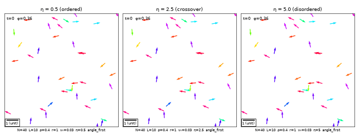
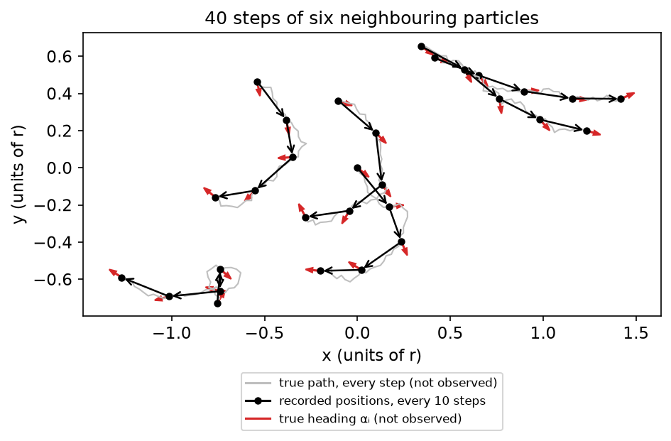
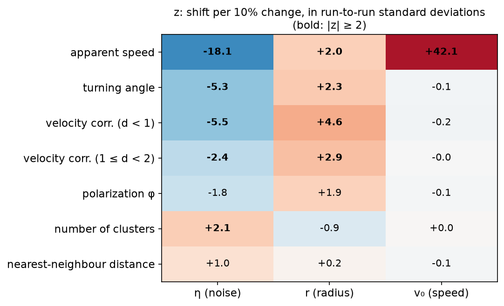
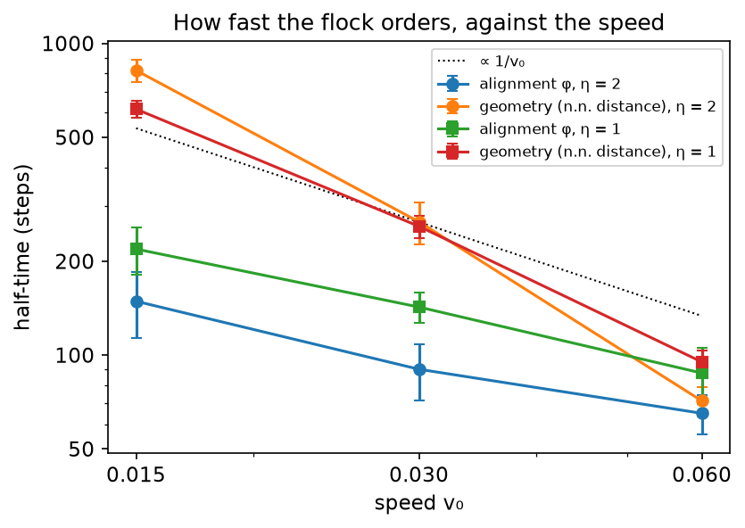
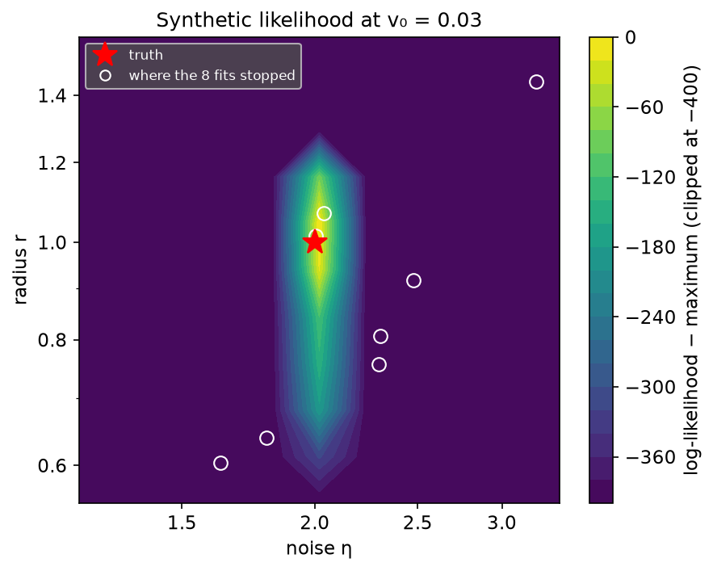
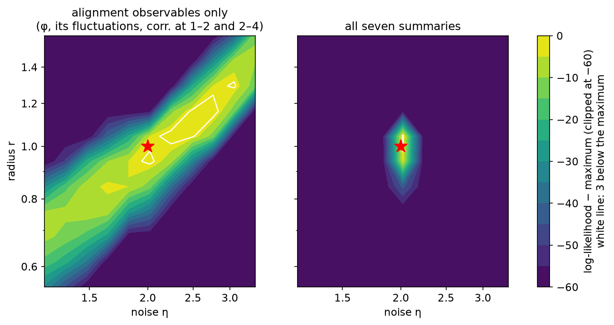
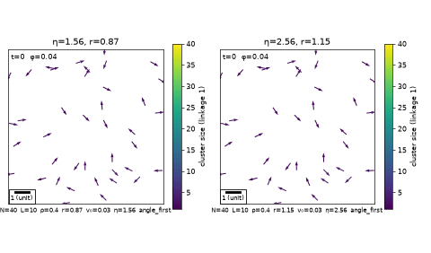
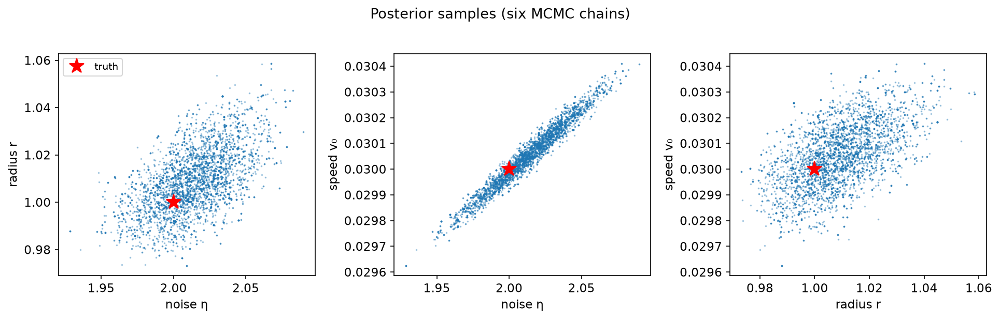

# Running a flock backwards

*What positions alone can tell you about the rules of a flock, how sure you can be, and what they cannot
tell you.*

by [Gabriel Baglietto](https://github.com/GabrielBaglietto)



Simulating a flock is easy. Forty particles, each copying the average heading of its neighbours with some
noise, will align, split and regroup as the noise changes, as in the animation above. This is the *forward*
direction: choose the rules, run them, look at what comes out.

This repository goes the other way. Start from the tracks, as a camera would record them, and ask **which
rules produced them**, **how precisely the tracks determine each rule**, and **which rules the tracks cannot
determine at all**. That is the *inverse* direction. It is harder than it looks, for two reasons a forward
modeller rarely has to face. The model is stochastic, so the same rules never produce the same tracks twice,
and there is no formula for the probability of a given set of tracks. And the observation is partial: a camera
sees positions, not the headings the rules act on.

We work on a system where the answer is known, because we simulate it ourselves, with 40 particles and only
what a camera would see. The method is climbed in steps. Each step answers a question the previous one could
not, and we explain at each one what makes the new tool more powerful than the one before. Every protocol was
written down before running it, so each step also shows where its reach ends, and that is what points to the
next one.

This is not a research paper. Its aim is more modest: to introduce, on a model physicists know well, the
questions and tools of inference from simulated data (a likelihood built by simulation, identifiability, honest
error bars, a posterior), each introduced at the point where it becomes necessary. None of the methods is new, and the
estimation problem is deliberately simple: synthetic data, few particles, a known model. Where the methods come
from, and research that goes much further, is in [Related work](#related-work).

For a slower path through the same ideas, with the mathematics written out, see the
[detailed explanation](EXPLANATION.md).

> **Notation.** θ = (η, r, v₀) is the vector of the model's parameters: η the amplitude of the angular noise,
> r the interaction radius (the unit of length), v₀ the speed (distance per step). The heading of particle i is
> the angle αᵢ.

## What are we trying to recover, and what do we get to see?

The model is the Vicsek model ([Vicsek et al., 1995](#references)). At every step each particle takes the
mean heading of all particles within a distance r, adds uniform angular noise of width η, and moves a distance
v₀ along its new heading. The three parameters are the rules we want to recover.

What we observe is deliberately poor, because that is what a real experiment gives. We record the
**positions** of the particles every 10 steps, and nothing else: no headings, which a camera cannot see, and
no intermediate steps. Every quantity we use is computed from those positions. From two consecutive frames we
get each particle's displacement; from three, how much it turned. From the positions of all particles in one
frame we get distances between them and, with them, clusters.

The design is 40 particles in a periodic box of side 10. That gives about 1.3 neighbours per particle within
r, so groups form, split and merge; in a much denser box the whole flock would be a single group. The true
values are θ* = (η, r, v₀) = (2, 1, 0.03). One "experiment" is 5000 steps observed after the flock has
forgotten its random start.



*What the simulation does and what we keep. Grey: the path of six neighbouring particles, step by step. Black:
the positions we record, one every 10 steps; the arrows join consecutive records, and they are all the data
contain. Red: the true heading αᵢ at each record, which the data do not contain.*

<details><summary>The model, in equations</summary>

Each particle i has a position **x**ᵢ and a heading αᵢ. At every step

$$\alpha_i(t+1) = \arg \sum_{|x_j - x_i| \le r} e^{i\alpha_j(t)} + \xi_i, \qquad \xi_i \sim U[-\eta/2,\ \eta/2]$$

$$x_i(t+1) = x_i(t) + v_0\,(\cos\alpha_i(t+1),\ \sin\alpha_i(t+1)) \pmod L$$

with distances measured in a periodic box of side L. The order parameter is
$\varphi = |\frac1N\sum_i e^{i\alpha_i}|$. From the observed positions we compute displacements between
frames and their directions **u**ᵢ; the summaries of the next section are built from them and are defined, with
their equations, in [notebook 01](notebooks/01_observables.ipynb). A longer explanation is in the [detailed explanation](EXPLANATION.md#2-the-physical-model-the-vicsek-model).

</details>

## Which measurable quantities react to which rule?

From the positions we compute a handful of observables frame by frame and average each one over a run. Each
run is thereby reduced to a short list of numbers, the **summaries**. We use seven, in three groups:

- **Motion of each particle:** the *apparent speed* (net displacement between frames divided by the 10 steps)
  and the *turning angle* (the mean cosine of the angle between consecutive displacements).
- **Alignment between particles:** the *polarization* of the displacements (how parallel they are, from 0 to 1)
  and the *velocity correlation* between pairs closer than 1 and between pairs at distance 1 to 2.
- **Geometry of the flock:** the *number of clusters* (groups of particles linked by chains of neighbours
  closer than 1) and the *nearest-neighbour distance*.

The distances 1 and 2 are chosen by us in the units of the data; they are not the unknown radius r, even though
here, with r = 1, the two coincide.

We also compute three more, used only for comparison in a later section: the fluctuations of the polarization,
the velocity correlation at distances 2 to 4, and the size of the largest cluster.

A forward modeller's first instinct is to ask which observable is sensitive to which parameter: raise the
noise, watch the alignment drop. With stochastic data that is only half the question. Two runs with the same
rules already give different values of every observable, so a change in the rules is only visible if it moves
the observable **by more than it moves by chance**. What matters is the ratio of the two, a signal-to-noise
ratio.

We measure it as z: by how many run-to-run standard deviations a 10% change of one parameter shifts the
time average of an observable over one run. For example, raising the noise by 10% lowers the mean cosine of
the turning angle by about 5 times its run-to-run spread, so z ≈ −5 for that pair.

What does a given z buy? Picture the value of the observable in a single run as a bell curve, one for the
original rules and one for the rules changed by 10%. z is the distance between the two centres, measured in
widths of the bell. At |z| = 2 the bells are two widths apart but still overlap: deciding from one run which of
the two produced it is wrong about one time in six, and a standard test at the 5% level catches the change only
about half of the time. That is why we read |z| ≥ 2 as *one run is at the edge of noticing a 10% change*, not
as *one run settles it*; for a clear verdict it takes |z| of about 3 or more, or several runs. And z judges one
observable on its own. Several observables used together can do much better, or no better if they repeat the
same information, which is the question of a later section.

Three things came out, and they shaped everything after:

- **v₀ is seen by one number only.** The apparent speed responds to it strongly (z = 42); every other observable
  is blind to it at this speed, which is small compared with the interaction radius.
- **η and r are each seen by several observables.** The turning angle and the short-range velocity correlation
  respond to a 10% change of either by more than two standard deviations.
- **The geometric observables are slow.** Cluster counts and neighbour distances remember their state for 26–72
  frames, so one run gives only 7–19 independent looks at them, and they are the noisiest per run.



*The sensitivity z of each of the seven summaries (rows) to a 10% change of each rule (columns): the shift of
the summary's mean in units of its run-to-run standard deviation for one 5000-step run. Bold marks |z| ≥ 2;
the colour scale is compressed so that the small values stay visible next to the speed row.*

<details><summary>The sensitivity z</summary>

$$z = \frac{0.1\ \partial s/\partial \log\theta_q}{\mathrm{sd}(s)}$$

where s is a run's time-averaged observable, θ_q one component of θ, the derivative comes from ±10% differences
with the same random numbers, and sd(s) is its spread over 40 independent runs. See
[notebook 01](notebooks/01_observables.ipynb) §4. A longer explanation is in the [detailed explanation](EXPLANATION.md#19-the-sensitivity-z).

</details>

## Can one simple number tell us the rules?

The sensitivities judge each observable on its own, in the steady state. Before combining them, we tried the
summary of the dynamics a forward modeller reaches for first: a rate. For an epidemic it would be the early
growth rate; for a flock, how fast a disordered flock becomes ordered. We measured it from the approach of the
alignment and of the geometry to their final values.

The well-defined quantity is the **half-time**, the time to close half the gap to the final value: about 90
steps for the alignment and about 260 for the geometry, and robust. (A fitted exponential rate, which we had
planned first, is not: for the alignment, the noise of an average over five runs sits at the level where the
approach is judged to be over, so the fitted rate follows the noise. The protocol, written down before looking
at any curve, is what made this visible.)

The half-time carries real information about the speed: halving v₀ multiplies the geometric half-time by
2.4–3, because slower particles take longer to meet. Its limit is precision. It varies by 30–60% from one group
of runs to another, so seeing a 10% change of v₀ in it would take about a hundred groups. A rate answers its
own question, *how fast does it order*, with one number taken from a few hundred steps of transient.

The next step is more powerful in two ways. It uses the steady state, all 5000 steps of a run instead of the
first few hundred, and it uses all seven summaries at once, each weighted by how noisy it is.



*Half-time of the approach to the steady state, for an alignment observable (φ) and a geometric one (the
nearest-neighbour distance), at two noise levels. Error bars: standard error over the group of runs. Dotted:
a 1/v₀ law, for reference.*

## Can we fit all three rules at once?

To fit, a statistician maximises the **likelihood**: the probability of the observed data as a function of the
parameters. The parameters that make the data most probable are the estimate. For a deterministic model with
measurement noise this is familiar (least squares is a special case). For a stochastic simulator like ours it
is not available: there is no formula for the probability of a set of tracks.

The **synthetic likelihood** ([Wood, 2010](#references)) replaces the unknown formula by simulation. Reduce
each run to its seven summaries (listed in [Which measurable quantities react to which rule?](#which-measurable-quantities-react-to-which-rule)). For a candidate θ, simulate many runs (we use
40) and look at the cloud their summaries form. Approximate the cloud by a Gaussian, with the mean and the
covariance of the simulated summaries, and ask how probable the observed summaries are under it. If θ is right,
the observed point sits near the centre of its cloud; if θ is wrong, far out in the tail. The fit is the θ whose
cloud fits the observation best.

This is what the rate lacked: a single objective that uses every summary at once, knows how noisy each one is,
and takes their correlations into account, so that two summaries carrying the same information are not counted
twice.

The best fit lands at **θ̂ = (2.004, 1.014, 0.0300)**, within 1.5% of the truth, and changing the random
numbers of the simulations moves it by less than 1%.

The search for that fit shows the geometry of the problem. The randomness of the objective, which we expected
to be the obstacle, is small: about one unit of log-likelihood, while a 10% change of a parameter costs between
40 and 7400 units. What shapes the search is that the likelihood is a **thin, curved valley** in parameter
space, and its shape has a physical reading: along it, the noise and the speed increase together. More noise
makes the particles turn more, which shortens the net displacement over 10 steps; a faster particle
compensates, and the apparent speed stays the same. An optimiser stepping in straight lines tends to leave such
a valley: of 8 starts across the plausible range, 1 reached the top and one more came close.

A second protocol, written down before running it, uses what the first one showed: a better covariance
estimate, a cheap regression to choose the starting region, and steps scaled to that regression. It brings 4 of
8 starts close to the top instead of 2. Across 32 fits no competing optimum appeared, so the best of several
starts is a reliable estimate. (Proving that the optimum is unique, the criterion we had set, is beyond what
several starts can give.) The valley itself is a result: it returns in the next two sections.



*The synthetic log-likelihood on the (η, r) plane, with v₀ held at its true value 0.03, and the points where
the eight optimisations of the first attempt stopped (projected on this plane: each also has its own v₀, so a
point can lie off the bright region and still be on the valley in three dimensions).*

<details><summary>The synthetic likelihood</summary>

At θ, simulate B = 40 runs with summaries **s**₁…**s**_B, estimate their mean μ̂(θ) and covariance Σ̂(θ), and
evaluate

$$\ell(\theta) = -\tfrac12\,(\mathbf s_{\rm obs}-\hat\mu)^\top\hat\Sigma^{-1}(\mathbf s_{\rm obs}-\hat\mu) - \tfrac12\log\det\hat\Sigma$$

With the same random numbers at every θ, ℓ is a deterministic function that an optimiser can use. See
[notebook 03](notebooks/03_point_fit.ipynb). A longer explanation is in the [detailed explanation](EXPLANATION.md#29-synthetic-likelihood).

</details>

## Is the answer actually determined by the data?

A fit always returns numbers, even when the data do not determine them. The next tool is more powerful than a
fit because it says, direction by direction in parameter space, how well the data fix the parameters, and which
summary does the fixing. This is the question we find most useful. The idea is simple to picture. If two different sets of rules produce data that look the same
within the noise, no method can tell them apart, however good. In parameter space this shows up as a **ridge**:
a line along which the likelihood is nearly flat, so that every point on it explains the data about equally
well. Along the ridge the parameters are not determined one by one, only in combination.

The tool that measures this is the curvature of the likelihood at its peak (the Fisher information). A sharp
peak in some direction means the data pin the parameters down in that direction; a flat one means they do not.
From it come a standard error for each parameter and the correlation between their errors. A correlation near
±1 is the signature of a ridge: an error in one parameter is compensated by an error in another.

The answer depends on what you measure. Take the classic **alignment observables**, the ones used to measure
how aligned a flock is: the polarization φ, its fluctuations, and the velocity correlations at distances 1–2
and 2–4. (In [notebook 04](notebooks/04_identifiability.ipynb) this set is called the *φ-type* set; the seven
summaries of the fit are called the *fit set*.) With these alone, **noise and interaction radius trade off
along a ridge.** More noise can be compensated by a longer alignment range, and those
observables cannot tell the two apart: the errors in η and r are correlated at +0.97, and the best fit sits
*off* the truth, displaced along the ridge.



*The same plane (v₀ at its true value), with the likelihood built from the alignment observables only (left)
and from the seven summaries of the fit (right). The white line is 3 log-units below the maximum. Left, a long
ridge along which more noise is traded for a longer range; right, a narrow peak around the truth.*

The two flocks below lie on that ridge. Their noise differs by a factor 1.6 and their radius by 30%, and to the
eye they look different. Yet in the alignment observables they are only about 3 run-to-run standard deviations
apart. In the turning angle alone they are 16 apart.



**One cheap trajectory observable removes the confusion: the turning angle.** It measures the noise almost
directly, whatever the range of alignment. With the seven summaries the correlation drops to +0.76, the peak
sits on the truth, and r is determined to about ±5% (95%) from a single run of 40 particles. Removing each
summary in turn shows who carries what (se is the standard error of the logarithm, so 0.023 means about 2.3%):

| summaries | se(log η) | se(log r) | se(log v₀) | corr(η, r) |
|---|---|---|---|---|
| all seven | 0.016 | 0.023 | 0.0055 | +0.76 |
| alignment observables only | 0.178 | 0.128 | 2.0 | **+0.97** |
| without the turning angle | 0.032 | 0.041 | 0.012 | **+0.93** |
| without the short-range correlation | 0.017 | 0.031 | 0.0056 | +0.66 |
| without the apparent speed | 0.027 | 0.023 | 0.41 | +0.47 |
| without the polarization | 0.017 | 0.024 | 0.0056 | +0.76 |

The polarization, the observable a physicist reaches for first, turns out to be redundant once the others are
there. And one result went against our expectation: a dense box, where the whole flock is one cluster,
determines r *better* than the sparse one, because its runs fluctuate so little.

<details><summary>The Fisher information of a synthetic likelihood</summary>

With J = ∂μ/∂log θ (from ±10% differences) and Σ the covariance of the summaries, both estimated from 200 runs,

$$I = J^\top \Sigma^{-1} J$$

and I⁻¹ is the approximate covariance of log θ̂ from one run: its diagonal gives the standard errors, and its
off-diagonal terms the correlations. The table removes one summary at a time from J and Σ. See
[notebook 04](notebooks/04_identifiability.ipynb). A longer explanation is in the [detailed explanation](EXPLANATION.md#43-fisher-information).

</details>

## How sure can we be?

The curvature of the previous section gives error bars quickly but approximately: it assumes the likelihood
is a parabola near its peak, which it is only roughly. A more direct way is to ask how much the estimate would
change with different data. Since we can simulate, we can literally do that: pretend the fitted
rules are the truth, simulate many new datasets from them, fit each one exactly as we fitted the real one, and
look at the spread of the fits. That is the parametric bootstrap.

We did it with 30 new datasets and a control fixed in advance: five of the datasets refitted from a second
starting point, whose two fits should agree. The control is what made this step informative. The two fits of a
dataset differed by about one standard error, and the reason is a property of the problem: **the likelihood is
smooth at the scale of the fit and rough at the scale of the uncertainty.** A 10% change costs hundreds of
units, but a change of one standard error costs about one unit, the same as the small-scale jitter a chaotic
simulator leaves even with fixed random numbers. Any method that *maximises* the likelihood for each dataset
inherits that jitter. A second version, which smooths the likelihood with a fitted surface before maximising,
flagged a different, fixable problem in its own controls. The two versions agree on the size of the error bars
as orders of magnitude; to go further, a method must not depend on the exact location of a maximum.

The posterior is more powerful for exactly that reason: it does not maximise. The Bayesian answer is not a best point with a bar around it but a
**posterior**: a probability distribution over θ, giving each value a weight proportional to how well it
explains the data. It is explored with a Markov chain Monte Carlo (MCMC) random walk that visits each value of θ
in proportion to its weight, so it *averages* over the likelihood instead of chasing its peak. The catch is that
each step needs the likelihood, and we only have a noisy estimate of it by simulation. Pseudo-marginal MCMC
([Andrieu & Roberts, 2009](#references)) says that this is fine as long as the estimate is unbiased: the chain still
samples the same posterior as it would with the exact synthetic likelihood (the Gaussian approximation of the
summaries, not the true likelihood of the tracks), only more slowly.

The plain synthetic likelihood is biased; with 40 runs per evaluation it comes out up to twice too sharp.
The unbiased synthetic likelihood ([Price, Drovandi, Lee & Nott, 2018](#references)) fixes that, and fresh random
numbers at every step turn the roughness into noise the chain averages out. Six chains, started apart, agree,
and nothing was tuned after looking at them:

| | mean | 95% interval |
|---|---|---|
| η | 2.014 | [1.965, 2.061] |
| r | 1.009 | [0.985, 1.038] |
| v₀ | 0.0301 | [0.0298, 0.0303] |

The truth (2, 1, 0.03) is inside all three intervals. The posterior also shows what no point fit could: η and
v₀ lie on a thin straight ridge (correlation +0.98), the same valley that stalled the optimiser. They are known
much better as a pair than one by one.



*Samples of the posterior from the six MCMC chains after burn-in, one pair of parameters per panel (every
fourth sample shown). The thin straight cloud in the middle panel is the η–v₀ ridge.*

<details><summary>Unbiased synthetic likelihood and pseudo-marginal MCMC</summary>

The estimator of the Gaussian density from n simulations is exactly unbiased for n > d + 3, with d the number of
summaries ([Ghurye & Olkin, 1969](#references); we use the formula as written in [An, South & Drovandi,
2022](#references), eq. 3). Replacing the true likelihood by an
unbiased positive estimate in a Metropolis–Hastings chain still samples the exact posterior; the noise only slows
the chain. We use n = 30 runs per estimate, chosen by a rule fixed in advance. See
[notebook 06](notebooks/06_posterior.ipynb). A longer explanation is in the [detailed explanation](EXPLANATION.md#59-bayesian-inference).

</details>

## What does each step add to the one before?

Each step answers a question the previous one could not, and each is more powerful in a specific way:

- **The sensitivities** (01) judge one observable against one parameter, in units of its own noise, and map
  which summary carries which rule.
- **The half-time** (02) turns the approach to order into one number that depends strongly on v₀. It is well
  defined, but it uses only a few hundred steps of transient, and it is imprecise.
- **The synthetic likelihood** (03) uses the whole steady state and all seven summaries at once, weighted by
  their noise and their correlations. It gives a fit within 1.5% of the truth, and it reveals the η–v₀ valley.
- **The Fisher information** (04) goes beyond a point: it says in which directions the data fix the
  parameters, and which summary does it. It finds the η–r ridge of the alignment observables, and the turning
  angle that removes it.
- **The parametric bootstrap** (05) replaces the parabola by refits of new simulated data, and its controls
  measure the roughness of the likelihood at the scale of the uncertainty.
- **The posterior** (06) averages over the likelihood instead of maximising it, so that roughness no longer
  matters. It gives intervals that contain the truth and the whole shape of the uncertainty, the η–v₀ ridge
  included.

Every protocol, with its stopping criterion, was written down before running it. Where a step reaches its
limit is recorded in its notebook, because that limit is what motivated the next step.

## Related work

The methods come from elsewhere, and research on flocks goes much further than this study.

- **Inferring interactions in real flocks.** Bialek et al. (2012) built maximum-entropy models from snapshots of
  starling flocks and inferred the strength and range of alignment directly from data. Attanasi et al. (2014)
  showed that turning in real flocks carries inertia, which a Vicsek-type rule lacks. Both work with real
  three-dimensional data and many birds; here the data are synthetic and the model is known.
- **Learning interaction rules from trajectories.** Lu, Zhong, Tang & Maggioni (2019) infer the interaction law
  itself, non-parametrically, from observed trajectories. We assume the form of the law and estimate three
  parameters, which is what lets us ask whether each is determined.
- **Inference from simulators.** The synthetic likelihood (Wood, 2010) is one member of a family that includes
  approximate Bayesian computation and neural simulation-based inference; Cranmer, Brehmer & Louppe (2020)
  review the field. We chose the synthetic likelihood because its assumptions are few and visible, and because
  its unbiased version (Price et al., 2018), combined with pseudo-marginal MCMC (Andrieu & Roberts, 2009),
  samples the posterior of that Gaussian approximation without any further approximation.

## What this study does not show

- The data are **simulated**. The rules are known, which is the point, but no real flock has been analysed.
- The box is **periodic**. There are no walls and no collisions between particles.
- There are **40 particles**, and one design point (the box size and the true rules).
- There is **no tracking noise**. With it, the apparent speed would lose precision, and v₀ would be harder to
  pin down.
- The angular noise is **uniform**, as in the original model.
- The summaries are treated as **Gaussian**, an assumption of the synthetic likelihood.

## The notebooks

| | question | notebook |
|---|---|---|
| 00 | Is the simulator right, and what does it do? | [00_simulator](notebooks/00_simulator.ipynb) |
| 01 | What do we observe, and which summaries carry which parameter? | [01_observables](notebooks/01_observables.ipynb) |
| 02 | Can a rate tell us the rules? | [02_rate](notebooks/02_rate.ipynb) |
| 03 | Can we fit all three at once? | [03_point_fit](notebooks/03_point_fit.ipynb) |
| 04 | Is r identified, and where is the degeneracy? | [04_identifiability](notebooks/04_identifiability.ipynb) |
| 05 | How uncertain is the fit? | [05_bootstrap](notebooks/05_bootstrap.ipynb) |
| 06 | What is the posterior? | [06_posterior](notebooks/06_posterior.ipynb) |

## Reproduce

Requires [uv](https://docs.astral.sh/uv/) (it installs Python 3.13 if needed).

```bash
git clone https://github.com/GabrielBaglietto/inference-ladder-vicsek.git
cd inference-ladder-vicsek
uv sync --group notebooks
uv run pytest                      # the package tests
uv run jupyter lab                 # open the notebooks
```

The notebooks keep their outputs, so they can be read on GitHub without running anything. Executed again,
all seven take a few minutes: the long runs (the fits of 03, the Fisher runs of 04, the bootstrap of 05 and
the MCMC chains of 06, about 18 hours of computing together) are loaded from `results/`. Each file there is
written by a script in `scripts/`, which regenerates it from scratch:

```bash
uv run python scripts/a6_posterior.py   # e.g. the six MCMC chains: ~12 h on 6 cores
```

The static figures of this README are drawn from `results/` by one script, in a few seconds:

```bash
uv run python scripts/make_figures.py
```

Simulations are cached on disk (`data/cache/`), so an interrupted run resumes where it stopped.

## References

- An, Z., South, L. F. & Drovandi, C. (2022). BSL: An R package for efficient parameter estimation for
  simulation-based models via Bayesian synthetic likelihood. *Journal of Statistical Software* 101(11).
  [doi:10.18637/jss.v101.i11](https://doi.org/10.18637/jss.v101.i11) (preprint: arXiv:1907.10940)
- Andrieu, C. & Roberts, G. O. (2009). The pseudo-marginal approach for efficient Monte Carlo computations.
  *Annals of Statistics* 37(2), 697–725. [doi:10.1214/07-AOS574](https://doi.org/10.1214/07-AOS574)
- Attanasi, A. et al. (2014). Information transfer and behavioural inertia in starling flocks. *Nature Physics*
  10, 691–696. [doi:10.1038/nphys3035](https://doi.org/10.1038/nphys3035)
- Bialek, W., Cavagna, A., Giardina, I., Mora, T., Silvestri, E., Viale, M. & Walczak, A. M. (2012). Statistical
  mechanics for natural flocks of birds. *PNAS* 109(13), 4786–4791.
  [doi:10.1073/pnas.1118633109](https://doi.org/10.1073/pnas.1118633109)
- Cranmer, K., Brehmer, J. & Louppe, G. (2020). The frontier of simulation-based inference. *PNAS* 117(48),
  30055–30062. [doi:10.1073/pnas.1912789117](https://doi.org/10.1073/pnas.1912789117)
- Ghurye, S. G. & Olkin, I. (1969). Unbiased estimation of some multivariate probability densities and related
  functions. *Annals of Mathematical Statistics* 40(4), 1261–1271.
  [doi:10.1214/aoms/1177697501](https://doi.org/10.1214/aoms/1177697501)
- Lu, F., Zhong, M., Tang, S. & Maggioni, M. (2019). Nonparametric inference of interaction laws in systems of
  agents from trajectory data. *PNAS* 116(29), 14424–14433.
  [doi:10.1073/pnas.1822012116](https://doi.org/10.1073/pnas.1822012116)
- Price, L. F., Drovandi, C. C., Lee, A. & Nott, D. J. (2018). Bayesian synthetic likelihood. *Journal of
  Computational and Graphical Statistics* 27(1), 1–11.
  [doi:10.1080/10618600.2017.1302882](https://doi.org/10.1080/10618600.2017.1302882)
- Vicsek, T., Czirók, A., Ben-Jacob, E., Cohen, I. & Shochet, O. (1995). Novel type of phase transition in a
  system of self-driven particles. *Physical Review Letters* 75, 1226–1229.
  [doi:10.1103/PhysRevLett.75.1226](https://doi.org/10.1103/PhysRevLett.75.1226)
- Wood, S. N. (2010). Statistical inference for noisy nonlinear ecological dynamic systems. *Nature* 466,
  1102–1104. [doi:10.1038/nature09319](https://doi.org/10.1038/nature09319)


## License

MIT — see [LICENSE](LICENSE).
